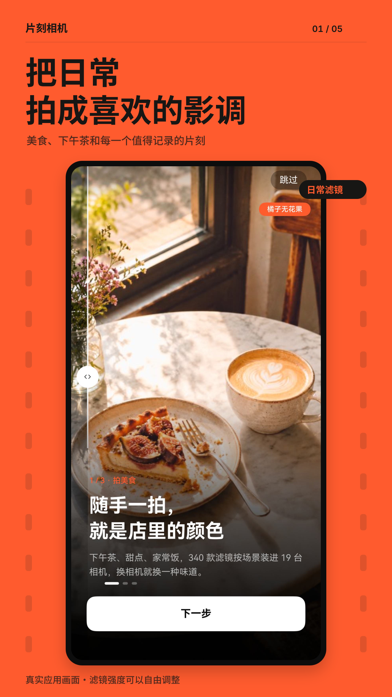
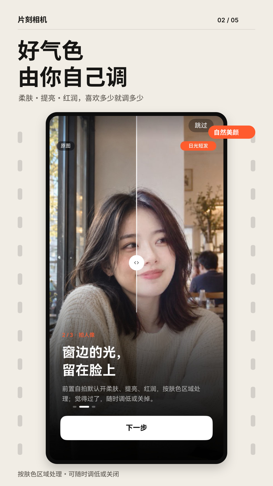
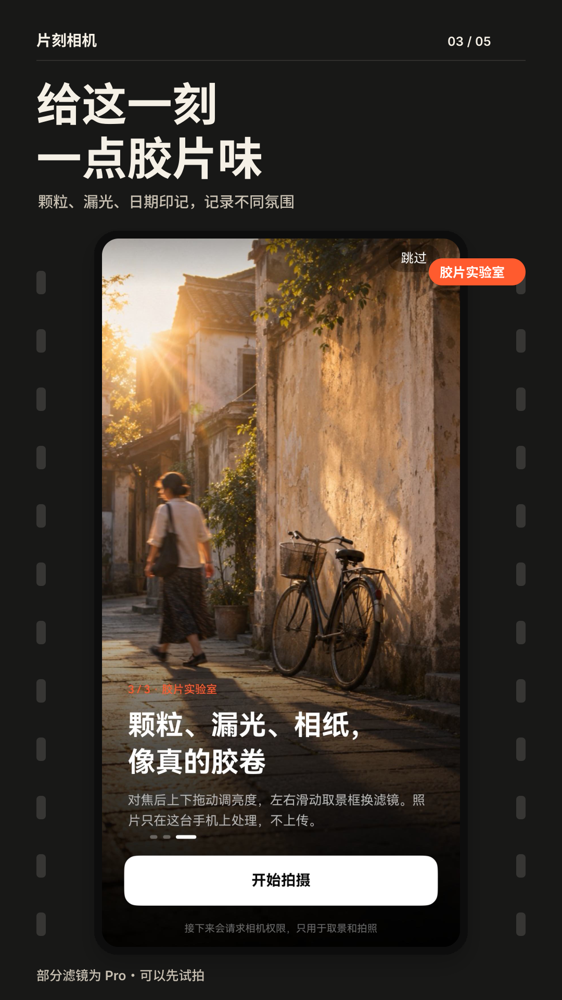
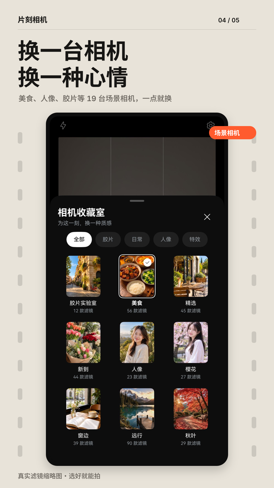
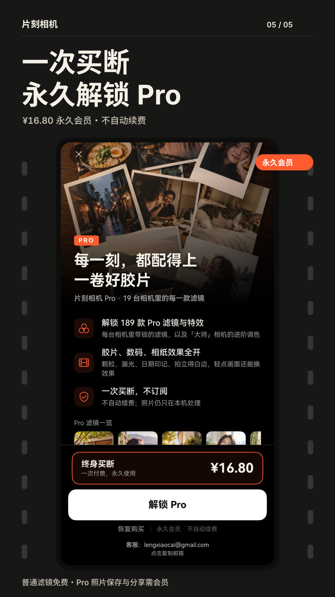

# App4U 推荐｜片刻相机

> App4U 是我计划做的一个免费应用推荐项目，专注于分享独立开发者及小团队的优质作品。
>
> 因我本人也是从独立开发做起，深知流量获取之难，也常见很多独立开发者朋友苦于运营乏力，遂发起此项目，希望让更多用心、有创意的应用被看见，也希望给大家介绍一些好的作品。
>
> App4U **完全免费**，目前采用内部筛选发布，纯兴趣，不做付费投稿。
> 
> 如您有喜欢的项目希望让更多人看到，也欢迎提供资料，感谢～
> 上一期 [App4U 推荐｜吃有数]()

## 推荐语

我主力机现在是 Pura X Max，这几天出门游玩拍了很多照片，想找个类似安卓上 SnapSeed 的滤镜 App，发现鸿蒙市场并没有太多选择，正好想起来【冷小菜】开发的【片刻相机】，下载体验了一下，没想到功能非常完整，滤镜也很多（我本来以为他只是想拿激励来着），所以这次想先推荐一下。

---

## App 信息

**App名称：** 片刻相机

**简介：** 打开就能拍的滤镜相机，咖啡甜点、家常饭、自拍和街景，一拍就是喜欢的影调。

## 核心功能：

- 美食滤镜：「美食」相机专门为下午茶、甜点和正餐调色，咖啡、蛋糕、家常菜都能找到合适的颜色；滤镜条上方按美食、人像、胶片分类，点一下就切换。
- 19 台场景相机：胶片实验室、精选、人像、樱花、窗边、远行、秋叶等，340 款滤镜按场景分好；强度 0–100 可调，在取景框上左右滑动就能换滤镜。
- 胶片质感：12 款胶片实验室配方，带颗粒、漏光、日期印记、拍立得白边和相纸效果，轻点画面可以换一种效果。
- 人像美颜：前置自拍默认开启柔肤、提亮、红润，只作用于肤色区域，不瘦脸、不放大眼睛，可以调低或关闭。
- 相册导入调色：从系统相册选一张照片，在手机上直接套用滤镜，按住画面对比原片。不需要相册权限，选哪张才读哪张。
- 带滤镜的短视频：可以拍 2 分钟以内的有声短视频；照片和视频都在手机上处理和保存，不上传。

## 应用截图

## 支持的平台：

- HarmonyOS（HarmonyOS NEXT 手机，在华为应用市场搜「片刻相机」）

## 收费方式：

- 免费 + 无广告：普通滤镜、美颜、强度调节和相册导入都免费
- Pro 滤镜可以先试拍，保存和分享需要会员
- 永久会员 ¥16.8，一次买断，不自动续费，支持恢复购买
- 成为会员后，后续所有新开发的滤镜也将直接可用，无需再次付费。

## 补充

- 下载：鸿蒙应用市场搜索「片刻相机」
- 联系邮箱：lengxiaocai@gmail.com

## 开发者信息

个人独立开发者冷小菜，专注做鸿蒙原生应用，目前在华为应用市场上架了 50 多款应用。其他作品包括：

- 墨刻：Markdown 笔记
- 中国法律查询手册：离线查法条
- 月月记：经期记录
- 小白证件照：手机拍证件照
- 一键打码：截图和照片快速打码
- 入眠小屋：白噪音助眠
